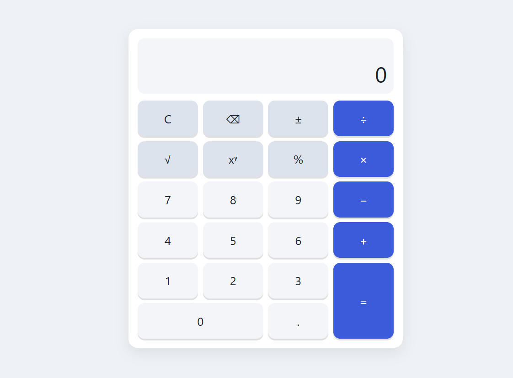

# Sezzle Calculator

A full-stack calculator: a Go REST API that performs the arithmetic and a React + TypeScript frontend that consumes it.

> **Screenshot:**



- **Backend:** Go 1.27, standard library only (`net/http` routing patterns, `encoding/json`, `log/slog`).
- **Frontend:** Vite + React 19 + TypeScript (strict), plain CSS modules, no UI or state libraries.
- **Operations:** add, subtract, multiply, divide, power, square root, percent.
- **Delivery:** Docker Compose (distroless API + nginx serving the SPA and proxying `/api`), GitHub Actions CI.

## Contents

1. [Prerequisites](#prerequisites)
2. [Running locally](#running-locally)
3. [API reference](#api-reference)
4. [Testing and coverage](#testing-and-coverage)
5. [Design decisions](#design-decisions)
6. [Assumptions](#assumptions)
7. [Future work](#future-work)
8. [AI usage](#ai-usage)

## Prerequisites

| Tool | Version | Needed for |
|---|---|---|
| Go | 1.27+ | backend |
| Node.js | 24+ (npm 11+) | frontend |
| Docker | 24+ with Compose v2 | containerized run |
| GNU Make | any | convenience targets (optional) |
| gcc | any | `go test -race` (the race detector needs cgo) |

## Running locally

### With Make

```bash
make frontend-install   # once: npm ci
make backend-run        # API on http://localhost:8080
make frontend-dev       # in a second terminal: UI on http://localhost:5173
```

The Vite dev server proxies `/api` to `http://localhost:8080`, so the UI calls the API through the same origin.

### Without Make

```bash
cd backend && go run ./cmd/server
cd frontend && npm ci && npm run dev
```

### Backend configuration

| Variable | Default | Meaning |
|---|---|---|
| `PORT` | `8080` | Listen port |
| `CORS_ALLOWED_ORIGINS` | `http://localhost:5173` | Comma-separated origins allowed to call the API cross-origin |
| `STATIC_DIR` | empty | If set, also serve a built frontend from this directory, with an `index.html` fallback for unknown non-API paths |

The frontend reads `VITE_API_BASE_URL` at build time (default: same origin).

`./server -healthcheck` performs `GET http://localhost:$PORT/healthz` and exits 0 on 200, 1 otherwise. The distroless image has no `curl`, so this is how Docker checks health.

### With Docker

```bash
make start              # build and run in the background, wait until healthy
make stop               # stop and remove the containers

make docker-run         # same, but attached to the terminal with live logs (Ctrl+C stops)
```

Open http://localhost:8080. nginx serves the UI and proxies `/api/` and `/healthz` to the backend, which has no published port. The frontend container starts only after the backend healthcheck passes. `make docker-build` builds the images without starting them.

## API reference

Every response, success or error, has `Content-Type: application/json`. The one exception is 404/405 for unknown routes or wrong methods, which come from Go's router as plain text.

### `POST /api/v1/calculate`

Request:

```json
{ "operation": "divide", "operands": [10, 2] }
```

| Field | Type | Rules |
|---|---|---|
| `operation` | string | Required. One of the names from `GET /api/v1/operations`. |
| `operands` | number[] | Required. Length must equal the operation's arity. No `null` elements, no numeric strings. |

The body is limited to 1 MB. Unknown fields and any data after the JSON object are rejected.

Response `200`:

```json
{ "operation": "divide", "operands": [10, 2], "result": 5 }
```

### `GET /api/v1/operations`

```json
{
  "operations": [
    { "name": "add", "arity": 2 },
    { "name": "divide", "arity": 2 },
    { "name": "multiply", "arity": 2 },
    { "name": "percent", "arity": 2 },
    { "name": "power", "arity": 2 },
    { "name": "sqrt", "arity": 1 },
    { "name": "subtract", "arity": 2 }
  ]
}
```

| Operation | Arity | Result |
|---|---|---|
| `add` | 2 | a + b |
| `subtract` | 2 | a − b |
| `multiply` | 2 | a × b |
| `divide` | 2 | a ÷ b; b = 0 is an error |
| `power` | 2 | a ^ b |
| `sqrt` | 1 | √a; a < 0 is an error |
| `percent` | 2 | a × b / 100 ("b percent of a") |

### `GET /healthz`

```json
{ "status": "ok" }
```

### Errors

Every error has the same shape:

```json
{ "error": { "code": "DIVISION_BY_ZERO", "message": "divide: division by zero" } }
```

Clients should branch on `code`. `message` is human-readable context and may change.

| Code | Status | Cause |
|---|---|---|
| `INVALID_JSON` | 400 | Malformed JSON, unknown fields, wrong types (including `"5"`), trailing data |
| `MISSING_FIELD` | 400 | `operation` or `operands` missing or `null`, or a `null` operand |
| `UNKNOWN_OPERATION` | 400 | Operation name not in the registry |
| `INVALID_ARITY` | 400 | Wrong number of operands |
| `PAYLOAD_TOO_LARGE` | 413 | Body exceeds 1 MB |
| `DIVISION_BY_ZERO` | 422 | Divisor is 0 |
| `NEGATIVE_SQRT` | 422 | Square root of a negative number |
| `NON_FINITE_RESULT` | 422 | Result is NaN or ±Infinity (e.g. overflow) |
| `INTERNAL_ERROR` | 500 | Anything else; details are logged, never returned |

### curl examples

```bash
API=http://localhost:8080

# 200 success
curl -s -X POST $API/api/v1/calculate -H 'Content-Type: application/json' \
  -d '{"operation":"divide","operands":[10,2]}'
# {"operation":"divide","operands":[10,2],"result":5}

# 400 INVALID_JSON (number sent as a string)
curl -s -X POST $API/api/v1/calculate -d '{"operation":"add","operands":["5",1]}'

# 400 MISSING_FIELD (null operand)
curl -s -X POST $API/api/v1/calculate -d '{"operation":"add","operands":[1,null]}'

# 400 UNKNOWN_OPERATION
curl -s -X POST $API/api/v1/calculate -d '{"operation":"mod","operands":[1,2]}'

# 400 INVALID_ARITY
curl -s -X POST $API/api/v1/calculate -d '{"operation":"sqrt","operands":[1,2]}'

# 413 PAYLOAD_TOO_LARGE
python3 -c "print('{\"operation\":\"' + 'a'*1100000 + '\"}')" | \
  curl -s -X POST $API/api/v1/calculate --data-binary @-

# 422 DIVISION_BY_ZERO
curl -s -X POST $API/api/v1/calculate -d '{"operation":"divide","operands":[1,0]}'

# 422 NEGATIVE_SQRT
curl -s -X POST $API/api/v1/calculate -d '{"operation":"sqrt","operands":[-4]}'

# 422 NON_FINITE_RESULT
curl -s -X POST $API/api/v1/calculate -d '{"operation":"power","operands":[10,400]}'

# 405 wrong method
curl -s -i $API/api/v1/calculate

curl -s $API/api/v1/operations
curl -s $API/healthz
```

## Testing and coverage

```bash
make test               # backend (go test -race) + frontend (vitest)
make lint               # gofmt -l, go vet, eslint, tsc
make backend-coverage   # writes backend/coverage.out and backend/coverage.html
make frontend-coverage  # writes frontend/coverage/index.html (plus a text summary)
```

Current coverage:

| Package | Statements |
|---|---|
| `backend/internal/calculator` | 100% |
| `backend/internal/httpapi` | 97.7% |
| `backend/cmd/server` | 75.9% (`main()` itself is not unit-tested) |
| **Backend total** | **91.1%** |
| **Frontend total** | **96.9%** (94 tests) |

What the tests cover:

- **calculator:** table-driven tests for every operation (normal, negative, decimal, zero, large values) and every registry rule (unknown operation, arity, wrapped errors, NaN/±Inf), plus `Operations()` ordering.
- **httpapi:** handler tests with a fake `Calculator` for success and every error-table row, unknown fields, `null` and string operands, trailing data, oversized body, wrong method; middleware tests for CORS, panic recovery and request logging.
- **cmd/server:** an integration test over real HTTP with the real registry; static serving with SPA fallback; config loading; healthcheck; graceful shutdown.
- **frontend:** reducer tests for every state transition, client tests with mocked `fetch` (success, error code, network failure, malformed response), and component tests for user flows (`5 + 3 =` → `8`, division by zero, keyboard input, loading disables input, stale responses ignored).

CI (`.github/workflows/ci.yml`) runs all of the above on every push and pull request to `main` and `development`.

## Design decisions

**Binary/unary operations instead of expression parsing.** The API takes one operation and its operands, and the frontend builds calculations step by step like a pocket calculator. This keeps the contract small, testable and free of precedence rules. *Rejected:* sending an expression string (`"2+3*4"`), which needs a tokenizer, parser and precedence rules on the server, and a different error model, for no gain in this UI.

**One `/calculate` endpoint and an operation registry.** Each operation is an `Operation{Name, Arity, Apply}` value registered in a `Registry` (Strategy + Registry). `Registry.Execute` applies the rules every operation shares, in one place: unknown name, arity, then the result must be finite. Adding an operation is one line in `defaultOperations()`, with no HTTP change (Open/Closed). *Rejected:* one endpoint per operation (`/add`, `/divide`…), which repeats validation and routing for each operation.

**Packages by responsibility, domain independent of HTTP.** `internal/calculator` is pure and never imports `net/http`. `internal/httpapi` depends on it, never the reverse. `httpapi` declares the small `Calculator` interface it needs, and `calculator.Registry` satisfies it implicitly, so handler tests use a fake. *Rejected:* layer folders (`models/`, `services/`, `utils/`) and a service layer between handler and registry, which add indirection without behaviour.

**Standard library only.** Go 1.22+ routing patterns (`POST /api/v1/calculate`) give method matching and 405s, and `log/slog` gives structured logs. *Rejected:* web frameworks (gin, echo, chi), which are unnecessary for three routes and add dependencies to audit.

**`float64` and display-side formatting instead of a decimal library.** IEEE 754 doubles are exact for integers up to 2⁵³ and give ~15–17 significant digits. Some results carry binary noise (`0.1 + 0.2 = 0.30000000000000004`). The API returns the exact `float64`; the UI rounds to 12 significant digits and strips trailing zeros (`0.3`). The UI also caps input at 15 digits, where float64 stops being exact. *Rejected:* arbitrary-precision decimals, which are correct for money but need a dependency, a string-based JSON contract and their own rules for `sqrt`/`power`, all beyond what a calculator demo needs.

**Pointer DTO fields.** The request decodes into `Operation *string` and `Operands []*float64`, so a missing field and a `null` operand are distinguishable from `0` and rejected with `MISSING_FIELD`. *Rejected:* plain `float64`, which silently turns `null` or an omitted field into `0`, a wrong answer instead of an error.

**NaN/Inf rejection.** JSON cannot represent NaN or ±Infinity (`encoding/json` fails on them), and they are not useful calculator answers. The registry checks every result once and returns `NON_FINITE_RESULT` (e.g. `10^400`, `(-8)^0.5`). *Rejected:* encoding them as strings or `null`, which breaks the `result: number` contract.

**Frontend state machine with `useReducer`.** The calculator is a pure reducer with explicit states (`idle`, `inputtingFirst`, `operatorPending`, `inputtingSecond`, `loading`, `result`, `error`). The reducer decides *what* to compute: the `loading` state holds the request. The component only performs the `fetch` and dispatches the outcome; responses that arrive after Clear are ignored. Every transition is unit-tested without React. *Rejected:* several `useState` flags, where impossible combinations (e.g. loading and error at once) can occur, or a state library, an extra dependency for one component.

**Two containers behind one origin.** In Docker, nginx serves the static build (hashed assets cached for a year, `index.html` with `no-cache`, gzip) and proxies `/api/` and `/healthz` to the backend. The browser sees a single origin, so no CORS is needed. The backend runs on distroless as non-root, with no published port. *Rejected:* a single container where the Go binary serves the frontend. That mode still exists (`STATIC_DIR`) for running one binary, but nginx handles static caching and compression better and keeps the API image minimal.

## Assumptions

- **Percent** is binary: `percent(a, b) = a × b / 100`, i.e. "b percent of a" (`200 % 15 = 30`). The keypad labels it "Percent of".
- **Precision:** results are IEEE 754 `float64`; the UI shows up to 12 significant digits. Inputs are limited to 15 digits.
- **Limits:** request body ≤ 1 MB; server timeouts are 5 s (headers), 10 s (read and write) and 60 s (idle); shutdown waits up to 10 s for in-flight requests.
- **Square root** applies to the current value (first operand or last result), not to a half-typed second operand.
- **Chaining:** pressing an operator after `a ∘ b` computes it first and uses the result as the next first operand, like a pocket calculator. There is no operator precedence.
- **Error messages:** the UI shows friendly text for known codes and falls back to the backend `message` for the rest.

## Future work

- Expression parsing with operator precedence and parentheses.
- Calculation history (client-side first, then persisted).
- Rate limiting and request IDs in logs.
- An OpenAPI spec, with generated client types instead of hand-written ones.
- JSON bodies for router-level 404/405 responses.
- A Docker image build and smoke test in CI.

## AI usage

This project was built with an AI coding assistant (Claude Code) in reviewed phases. Each prompt and a one-line outcome per phase are recorded in [PROMPTS.md](PROMPTS.md).
